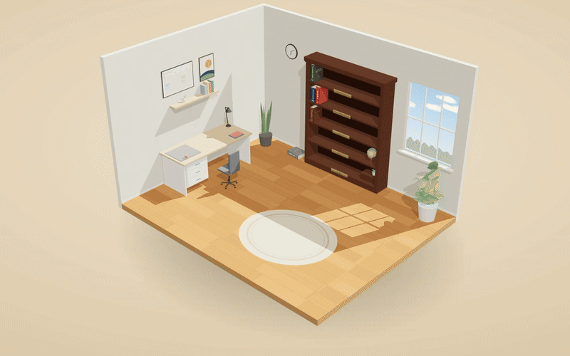
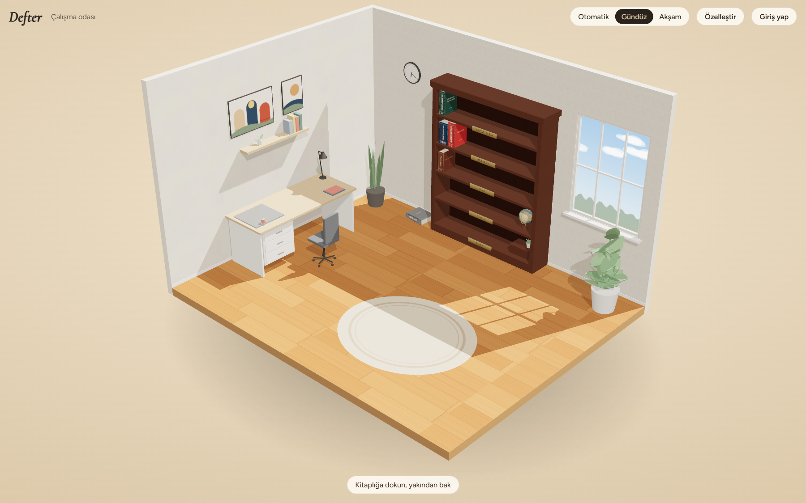
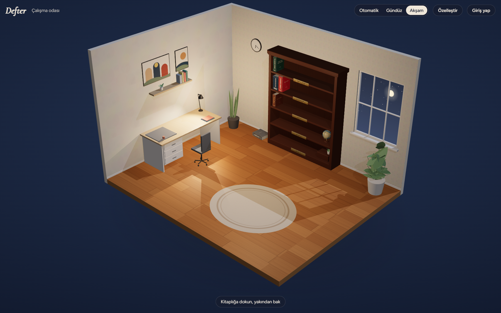
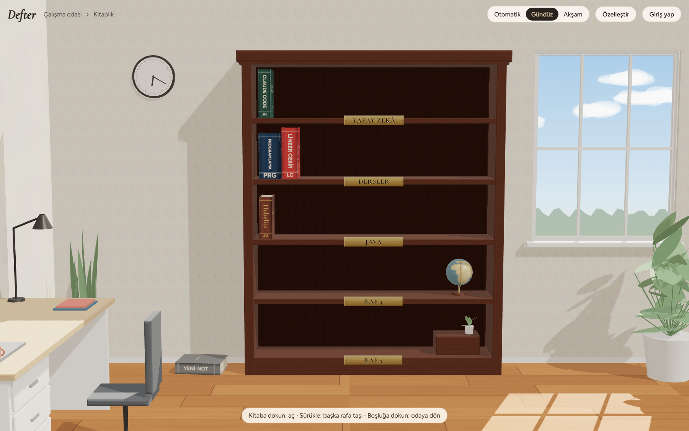
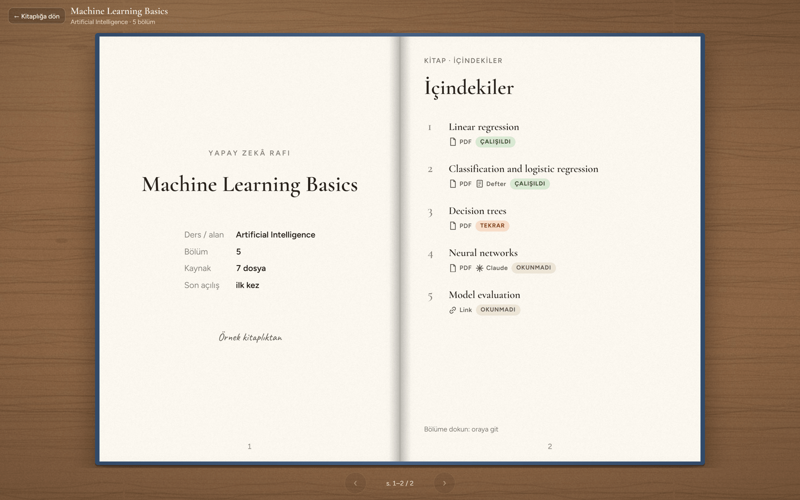
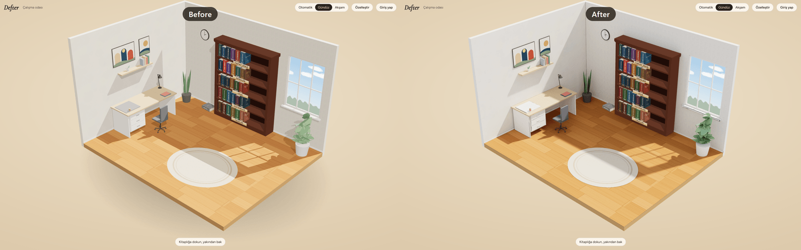
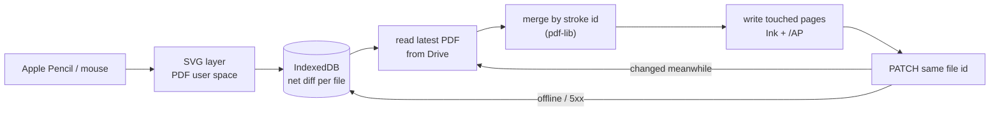
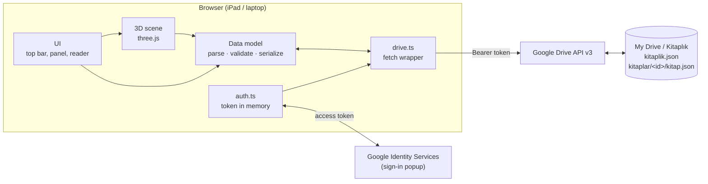
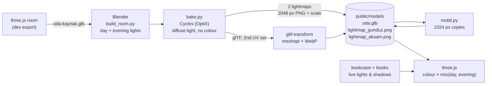

# Defter

**Your notes from Google Drive — PDFs, notebook photos and AI summaries — as books on the shelves of a 3D study room.**



**[▶ Try the live demo](https://defter-jade.vercel.app/?demo)** — opens a sample library, no sign-in needed.

---

## Why

As a student my notes live in three places at once: handwritten notebooks, lecture PDFs on my laptop, and summaries I create with AI tools. Each course ends up scattered across folders, photos and chat exports, and there is no single place that shows *what I have for a course and how far I am with it*.

Defter turns one Google Drive folder into a personal library. Every course or topic is a **book**; its chapters point to the PDFs, notebook photos, AI outputs and links that belong together. The files stay in your own Drive — Defter only arranges them.

## Features

| | |
|---|---|
|  | **A 3D study room** — a lit diorama with desk, plants, window and a bookcase, rendered with three.js. |
|  | **Day and evening** — switch manually or automatically after 18:00; the sun sets, the moon rises and the desk lamp turns on. |
|  | **Your shelves** — books are generated from Drive folders (cloth or leather covers, ribbons, dust on books you haven't opened in weeks). Drag books between shelves; new folders appear in the *new arrivals* pile. |
|  | **Open a book** — it flies to the desk and opens on a title page and a table of contents with chapter status (unread / studied / review) and source icons. |

- **Google sign-in, no server** — Google Identity Services in the browser; the access token is kept in memory only.
- **Saves back to Drive carefully** — shelf layout and room settings are written 1.5 s after the last change, after re-reading the latest file, touching only the fields Defter owns. Unknown fields are preserved; nothing is ever deleted, moved or copied.
- **Made for iPad** — touch gestures, no accidental page zoom, installable to the home screen.
- Customise shelves (2–6), shelf names, cover colours, wall and floor.

> The interface is in Turkish for now; an English option is planned.

## Visual quality



In Phase 2 the room got realistic lighting without changing its design:

- **Same room, better light** — the room is exported from three.js to Blender exactly as it is (same objects, colours, textures and layout). Only the light is computed again.
- **Baked with Cycles** — Blender's path tracer bakes soft sunlight, bounced light and soft shadows into two lightmaps: **day** and **evening** (desk lamp and moonlight). The lightmaps hold only light, no colour, so changing the wall or floor colour needs no new bake.
- **Blended by time** — three.js mixes the two lightmaps with a smooth transition when the room switches between day and evening (manually or automatically at 18:00).
- **Live where it matters** — the bookcase and books are not baked: they stay real-time, with live lights and shadows, so shelves, drag-and-drop and opening books work as before.
- **Light on mobile** — iPads and phones load 1024 px lightmaps instead of 2048 px (about 1 MB instead of 3 MB) and keep 30–60 fps.
- **Safe fallback** — if the baked room cannot be loaded within 15 s, the original real-time room is shown (`?oda=eski` forces it).

## Reading

Phase 3 turned the books into something you can actually read. A topic opens its lecture PDF, summary, exercise sheets and assignments as tabs, straight from Drive.

- **PDF.js rendering** — pages are drawn with PDF.js in a web worker. The library is loaded only when the first PDF opens, so the 3D room starts without it.
- **Virtual page list** — a 60-page script does not mean 60 canvases. Only the visible pages and two on each side are drawn; pages further away release their canvas memory, and every canvas stays under 16 megapixels (the iPad Safari limit). Pages keep their real size from the start, so the list never jumps.
- **PDF cache** — downloaded PDFs are stored in IndexedDB, keyed by file id and `modifiedTime`, so a changed file is fetched again automatically. Above 500 MB the least recently opened files are removed.
- **Book mode and PDF mode** — two pages side by side with page turns, or one continuous scroll. Landscape slides stay landscape. Pinch zoom scales the page with CSS first and redraws a sharp version of the visible part when the fingers lift.
- **Ribbons and reading status** — the reader remembers the page you stopped at for each material, and topics move forward on their own (unread → reading → read) as you open them and reach the last page.
- **Careful writes to Drive** — changes collect in a small patch. Before writing, Defter reads the latest `kitap.json`, applies only the fields that changed in this session, and checks `modifiedTime` again; if another device wrote in between, it retries. It always updates the same file (never creates a copy), keeps unknown fields, and holds the patch in memory while offline.

The live demo uses two PDFs generated by `scripts/demo-pdf-uret.mjs` (a 64-page portrait document and 24 landscape slides). Their text was written for the demo, so no lecture material is published.

## Pen / Annotations

Phase 4 added handwriting. With an Apple Pencil (or a mouse on the laptop) you can write straight onto any page, and the notes are saved inside the PDF itself, not in a separate format.

- **Tools** — pen, highlighter and eraser; 6 pen and 5 highlighter colours, three widths, undo / redo (Ctrl+Z, Ctrl+Shift+Z). Apple Pencil pressure shapes the line; without pressure (mouse, finger) it is estimated from the speed. Palm rejection: once the Pencil has been used, fingers only scroll and zoom.
- **Standard PDF annotations** — every stroke is written as a standard Ink annotation with an appearance stream (`/AP`), so the notes also show up in the Drive preview, Preview, Acrobat and other readers. Defter marks its own notes with a `/DefterId` key and only ever adds, changes or removes those. The page content, other annotations, form fields, metadata and page order stay untouched; signed PDFs are never written.
- **Live SVG layer** — while drawing, strokes live in an SVG layer above the page. Their coordinates are stored in PDF user space, so zoom, page rotation and crop boxes don't move them. The outline is drawn with [perfect-freehand](https://github.com/steveruiz/perfect-freehand); the live stroke, the reading layer and the `/AP` stream all come from the same shape function, so what you see is what is saved.
- **Saved twice, carefully** — strokes are first kept on the device as a net diff in IndexedDB, so closing the tab loses nothing. Uploading to Drive then reads the latest version of the file, merges the diff by stroke id, rewrites only the pages it touched, and updates the same file id (`PATCH`, resumable above 5 MB). If the file changed in between, it starts again (up to three times). Before the very first write, the original version is kept forever in Drive's revision history (`keepForever`). Offline, the diff waits and is retried.
- **Lazy pdf-lib** — [pdf-lib](https://pdf-lib.js.org/) is loaded only when the pen is switched on, or when a file already has Defter notes or unsaved strokes. Nothing else pays for it.



Writing to Drive is still behind a test switch (`?kalemYaz=1`) until it has been tested with a large real PDF; without it the strokes stay on the device.

**Try it:** open the [demo](https://defter-jade.vercel.app/?demo), choose *Programlamaya Giriş* → *Değişkenler ve veri tipleri* → the *Özet* tab. The summary already has a few handwritten notes; tap the pen button to add your own. The demo never writes to Drive — your strokes stay in your browser.

## Tech stack

- **TypeScript + Vite**, plain DOM (no framework)
- **three.js** for the 3D room (ACES tone mapping, soft shadows, canvas-generated textures)
- **Blender (Cycles)** for baked lighting, **gltf-transform** for compressing the room model
- **Google Identity Services** (OAuth 2.0 token client) for sign-in
- **Google Drive REST API v3** via `fetch`
- **Vercel** for static hosting

## Architecture

Everything runs in the browser. There is no backend: the app talks to Google directly with a short-lived access token.



### Baked lighting pipeline

The room geometry has one source: the three.js scene. Blender only adds light.



### Data model

A folder named `Kitaplık` in the root of My Drive:

```
Kitaplık/
  kitaplik.json                  ← shelves (in order) and room settings
  kitaplar/<book-id>/            ← one folder per book; folder name = book id
    kitap.json                   ← title, spine, code, course, cover, units and topics
    Unite-01-.../Konu-01-.../    ← one folder per topic
      orijinal.pdf               ← lecture material
      ozet.pdf                   ← summary (or brifing.pdf + sorular.pdf)
      Uebungen/*.pdf             ← exercise sheets
      Oedevler/*.pdf             ← assignments
```

`kitaplik.json` — the library:

```json
{
  "surum": 1,
  "raflar": [{ "id": "dersler", "ad": "Dersler", "kitaplar": ["programlamaya-giris", "lineer-cebir"] }],
  "oda": { "duvar": "#efe6d8", "zemin": "mese", "mod": "otomatik" }
}
```

`kitap.json` — one book:

```json
{
  "surum": 2,
  "baslik": "Programlamaya Giriş",
  "sirt": "Programlama",
  "kod": "PRG",
  "ders": "Bilgisayar Bilimi",
  "kapak": { "renk": "#24476b", "stil": "kumas" },
  "sonAcilis": null,
  "kurdele": { "konu": "Unite-01-Temeller/Konu-02-Kosullar", "materyal": "ozet", "dosya": "ozet.pdf", "sayfa": 7 },
  "uniteler": [
    {
      "baslik": "Temeller",
      "konular": [
        { "baslik": "Değişkenler ve veri tipleri", "klasor": "Unite-01-Temeller/Konu-01-Degiskenler", "durum": "calisildi" },
        {
          "baslik": "Koşullar ve döngüler",
          "klasor": "Unite-01-Temeller/Konu-02-Kosullar",
          "durum": "tekrar",
          "kurdeleler": { "ozet": { "dosya": "ozet.pdf", "sayfa": 7 } }
        }
      ]
    }
  ]
}
```

- A book has **units** (`uniteler`), a unit has **topics** (`konular`). `klasor` is the topic's folder, relative to the book folder.
- **Materials are found by looking into the topic folder** — files are not listed in `kitap.json`. Names are case-insensitive: `orijinal.pdf` (original), `ozet.pdf` or else `brifing.pdf` + `sorular.pdf` (summary), `Uebungen/*.pdf` and `Oedevler/*.pdf` (alphabetical). `X_cozum.pdf` is the solution of `X.pdf` in the same folder. Missing materials are hidden; a topic without any shows *no material yet*.
- `durum` (topic status), in this order: `okunmadi` (unread) → `okunuyor` (reading) → `okundu` (read) → `calisildi` (studied) → `tekrar` (review). Tapping cycles through them; the reader only moves a topic forward on its own (unread → reading → read).
- **Ribbons**: `kurdeleler` keeps the last page per material of a topic (`orijinal` · `ozet` · `uebungen` · `oedevler`); the book-level `kurdele` points to the last place read in the whole book.
- Older `surum: 1` books (a flat `bolumler` list with `kaynaklar`) still open: their chapters appear as topics of a single unit called *Genel*.
- A book folder without `kitap.json` still appears (folder name, grey cover). Books that are on no shelf appear in the *new arrivals* pile.
- Missing or broken fields fall back to defaults; unknown fields are kept and written back unchanged.

## Run locally

You need **Node.js 20+** and a Google account.

1. **Clone and install**
   ```bash
   git clone https://github.com/denizyarpinar/defter.git
   cd defter
   npm install
   ```
2. **Try it without Google** — `npm run dev`, then open <http://localhost:5173/?demo>. The sample library comes from `public/ornek/`.
3. **Create a Google OAuth Client ID** (for your own Drive) in the [Google Cloud Console](https://console.cloud.google.com/):
   1. Create a project.
   2. *APIs & Services → Library* → enable **Google Drive API**.
   3. *OAuth consent screen* → User type **External**, keep it in **Testing**, add your Google account under **Test users**.
   4. *Credentials → Create credentials → OAuth client ID* → type **Web application** → add `http://localhost:5173` under **Authorized JavaScript origins**.
4. **Add the Client ID** — create `.env.local` in the project root (it is git-ignored):
   ```
   VITE_GOOGLE_CLIENT_ID=1234567890-abc.apps.googleusercontent.com
   ```
5. **Prepare your Drive** — create a folder `Kitaplık` in the root of My Drive with a `kitaplar` folder inside. You can start from `referans/Kitaplik_ornek.zip`.
6. **Run** — `npm run dev`, open <http://localhost:5173> and sign in with Google.

Other scripts: `npm run build` (production build into `dist/`), `npm run typecheck` (`tsc --noEmit`), `npm run preview`, `npm run screenshots` (regenerates the images in `docs/`; needs Chrome and ffmpeg).

To deploy on Vercel, import the repository, set `VITE_GOOGLE_CLIENT_ID` as an environment variable, and add the Vercel URL to the Client ID's authorized JavaScript origins.

## Roadmap

- [x] **Phase 1 — Foundation:** project setup, 3D room, bookcase and books, Google sign-in, reading Drive and saving the shelf layout, deployment
- [x] **Phase 2 — Visual quality:** light baked in Blender (Cycles) into day and evening lightmaps, smaller files for mobile
- [x] **Phase 3 — Reading:** PDF rendering with pdf.js, book and PDF modes, zoom, ribbons and reading status
- [x] **Phase 4 — Pen:** Apple Pencil drawings saved into the PDF as standard annotations (pdf-lib) — on the `faz-4` branch, merge pending
- [ ] **Phase 5 — Notebook and adding:** notebook photos into the summary PDF, adding files
- [ ] **Phase 6 — Smart features:** OCR, search, quizzes and summaries

## Built with Claude Code

Defter is my first larger project, and I built it together with **[Claude Code](https://claude.com/claude-code)**, Anthropic's AI coding agent.

The product and architecture decisions are mine: the idea, the study-room concept and a clickable prototype I approved before writing the app, the Drive folder structure and JSON data model, the "no server, token only in memory" approach, and the rules for what the app may write to Drive. I split the work into small tasks, reviewed the plan for each one, and tested every step myself.

Most of the code was written by Claude Code from those plans. Working this way taught me a lot about three.js, OAuth and the Drive API, and about describing software precisely enough that it can be built.

## About

**Deniz Yarpinar** — Informatik @ Universität Bremen

## Kurzbeschreibung (Deutsch)

Defter ist eine Web-App, die Lernunterlagen aus Google Drive – PDFs, Fotos aus handschriftlichen Heften und KI-Zusammenfassungen – als Bücher in einem 3D-Arbeitszimmer darstellt. Jedes Fach ist ein Buch mit Kapiteln und Quellen; Bücher lassen sich per Drag-and-drop zwischen Regalen verschieben, und die Anordnung wird zurück nach Google Drive gespeichert. Die App läuft komplett im Browser (TypeScript, three.js, Google Identity Services, Drive API) und ist für das iPad optimiert. Konzept, Datenmodell und Architektur stammen von mir; der Großteil des Codes wurde mit Claude Code geschrieben.

---

© 2026 Deniz Yarpinar. All rights reserved.
