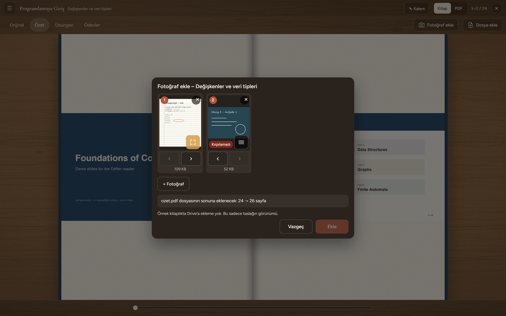
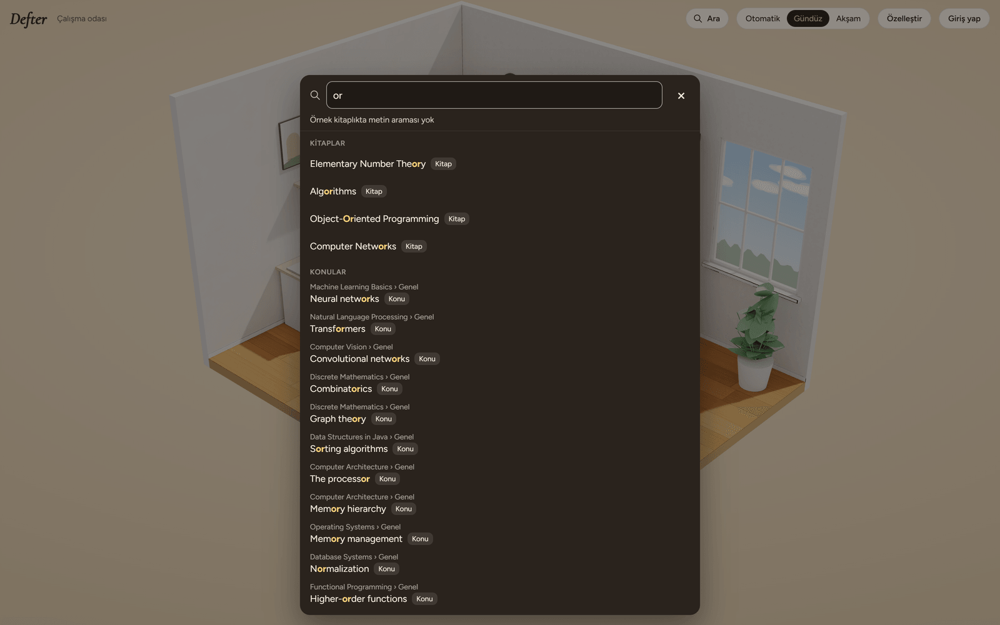
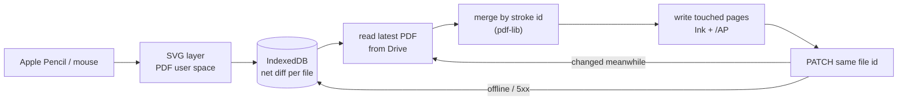
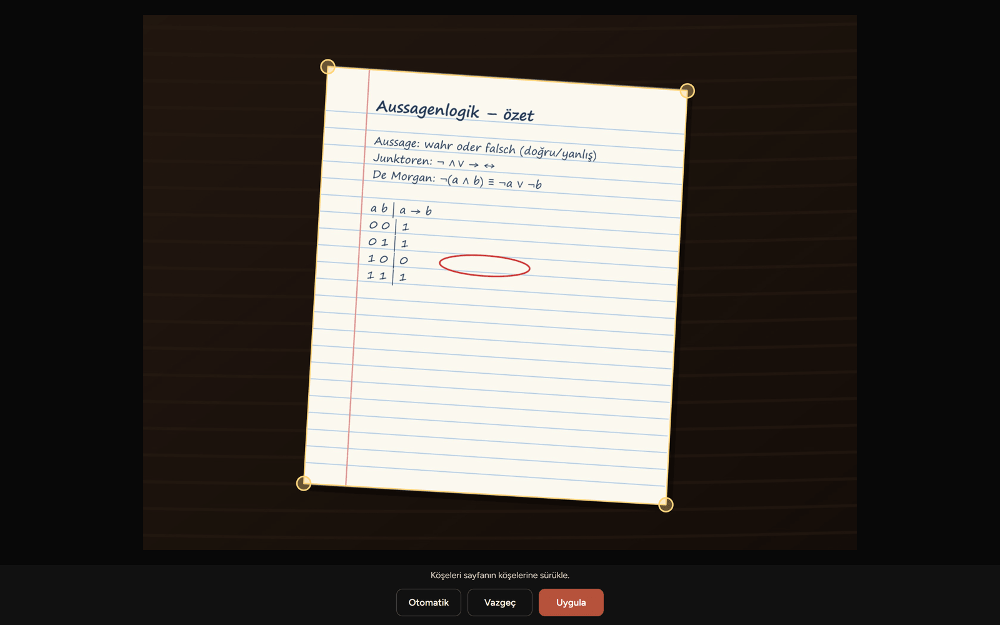
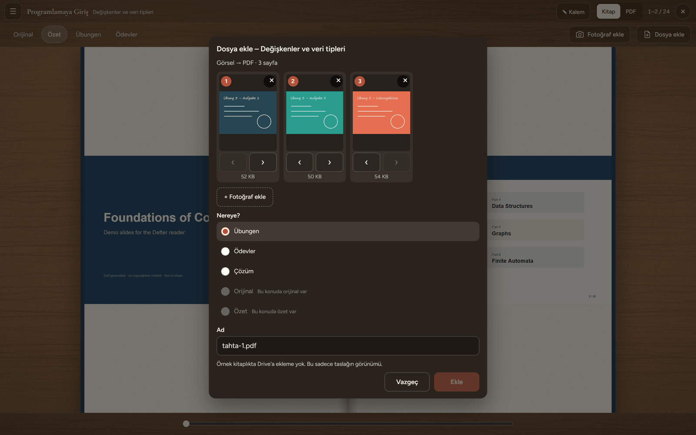
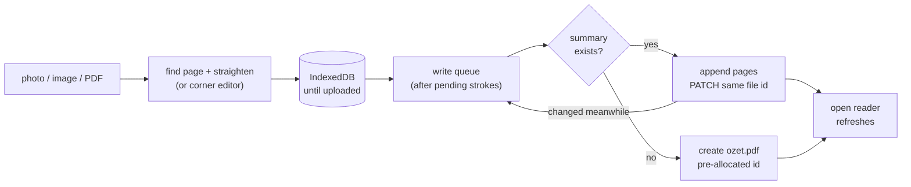
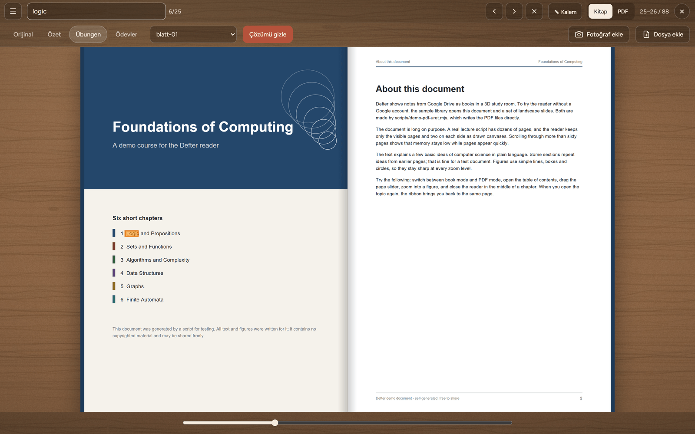
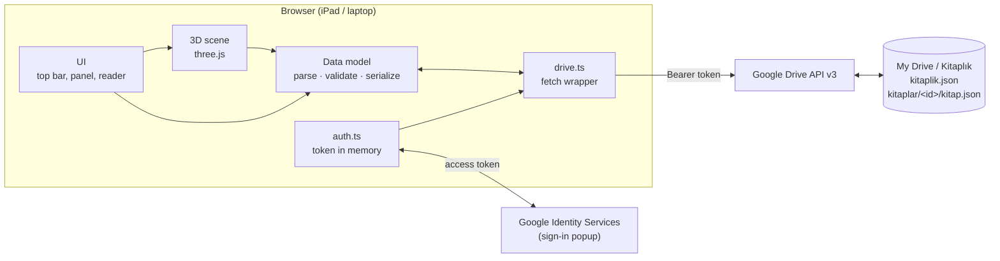
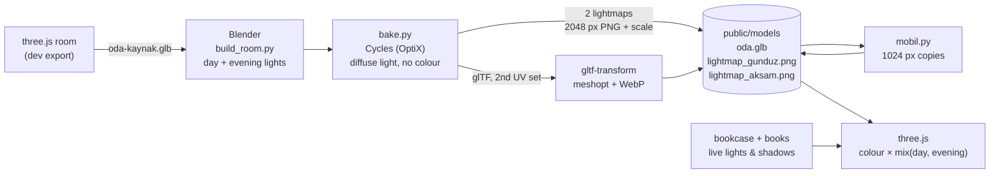

# Defter

**Your notes from Google Drive — PDFs, notebook photos and AI summaries — as books on the shelves of a 3D study room.**


**[▶ Try the live demo](https://defter-jade.vercel.app/?demo)** — opens a sample library, no sign-in needed.

---

## Getting started (preview)

> OAuth is in production; general rollout is still being prepared. The local Phase 6 code no longer requires a setup URL parameter; the deployed preview stays on its previous version until an approved push. The preview may require Vercel sign-in. The live demo above is a separate, sign-in-free sample.

Open the [Phase 6 preview](https://defter-git-faz-6-deniz-b571.vercel.app/) to try this flow with an authorised account. The interface is currently in Turkish; button labels below match the app.

1. **Sign in with Google** — choose *Google ile giriş yap* and review the requested permission.
2. **Set up your library** — on the *Kitaplığını kur* card, Defter offers to create a *Defter Library* folder and its library structure in your Drive. An existing library opens directly.
3. **Choose a sample book (optional)** — before confirming setup, leave *Örnek bir kitap da koy* checked to include a practice book, or uncheck it for an empty library. Press *Kitaplığı kur*.
4. **Create your own book** — open *Özelleştir → ＋ Yeni kitap*, choose its name, shelf and colour, then enter units and topics: a line such as `# Basics` starts a unit; following lines such as `Variables` and `Conditions` are its topics. Review the preview and press *Oluştur*.
5. **Open a topic** — open the book, then choose a topic from its table of contents. An empty topic is ready for its first file.
6. **Add a file** — choose *Dosya ekle*, select a PDF, image or a single Word/PowerPoint file, choose the material type (*Orijinal*, *Özet*, *Übungen* or *Ödevler*, as available), review the name and press *Ekle*. Word/PowerPoint files are converted to PDF through Google Drive.

Normal accounts use the narrow `drive.file` permission. **Files added manually in Drive are not automatically visible to Defter**, even if placed inside its library folder: add them through *Dosya ekle*. The configured owner account can use broader Drive access for its existing library.

Read the [privacy policy](public/privacy.html) and [terms of use](public/terms.html). These are the policy files in this repository branch; publishing them on the production site is still pending.

## Why

As a student my notes live in three places at once: handwritten notebooks, lecture PDFs on my laptop, and summaries I create with AI tools. Each course ends up scattered across folders, photos and chat exports, and there is no single place that shows *what I have for a course and how far I am with it*.

Defter turns one Google Drive folder into a personal library. Every course or topic is a **book**; its units and topics point to the PDFs, notebook photos, AI outputs and links that belong together. The files stay in your own Drive; Defter organises them and saves the changes you make through the app.

## Features

| | |
|---|---|
|  | **A 3D study room** — a lit diorama with desk, plants, window and a bookcase, rendered with three.js. |
|  | **Day and evening** — switch manually or automatically after 18:00; the sun sets, the moon rises and the desk lamp turns on. |
|  | **Your shelves** — books are generated from Drive folders (cloth or leather covers, ribbons, dust on books you haven't opened in weeks). Drag books between shelves; new folders appear in the *new arrivals* pile. |
|  | **Open a book** — it flies to the desk and opens on a title page and a table of contents with its units and topics, each with a status (unread → reading → read → studied → review). |
|  | **Add your notebook** — photograph handwritten pages; Defter finds the page, straightens it and appends it to the topic's summary PDF. PDFs and images can be added to a topic as well. |
|  | **Search** — find books, topics and files by name, and words inside your PDFs (Drive's full-text search). In the reader, search the open file: matches are highlighted and you jump between them. |

- **Google sign-in, no server** — Google Identity Services in the browser; the access token is kept in memory only.
- **Saves back to Drive carefully** — shelf layout and room settings are written 1.5 s after the last change, after re-reading the latest file, touching only the fields Defter owns. Unknown fields are preserved. The Phase 6 code also supports library creation and confirmed trash / undo actions; files are not permanently deleted by the app.
- **Made for iPad** — touch gestures, no accidental page zoom, installable to the home screen.
- Customise shelves (2–6), shelf names, cover colours, wall and floor.

> The interface is in Turkish for now; an English option is planned.

## Visual quality


In Phase 2 the room got realistic lighting without changing its design:

- **Same room, better light** — the room is exported from three.js to Blender exactly as it is (same objects, colours, textures and layout). Only the light is computed again.
- **Baked with Cycles** — Blender's path tracer bakes soft sunlight, bounced light and soft shadows into two lightmaps: **day** and **evening** (desk lamp and moonlight). The lightmaps hold only light, no colour, so changing the wall or floor colour needs no new bake.
- **Blended by time** — three.js mixes the two lightmaps with a smooth transition when the room switches between day and evening (manually or automatically at 18:00).
- **Live where it matters** — the bookcase and books are not baked: they stay real-time, with live lights and shadows, so shelves, drag-and-drop and opening books work as before.
- **Light on mobile** — iPads and phones load 1024 px lightmaps instead of 2048 px (about 1 MB instead of 3 MB) and keep 30–60 fps.
- **Safe fallback** — if the baked room cannot be loaded within 15 s, the original real-time room is shown (`?oda=eski` forces it).

## Reading

Phase 3 turned the books into something you can actually read. A topic opens its lecture PDF, summary, exercise sheets and assignments as tabs, straight from Drive.

- **PDF.js rendering** — pages are drawn with PDF.js in a web worker. The library is loaded only when the first PDF opens, so the 3D room starts without it.
- **Virtual page list** — a 60-page script does not mean 60 canvases. Only the visible pages and two on each side are drawn; pages further away release their canvas memory, and every canvas stays under 16 megapixels (the iPad Safari limit). Pages keep their real size from the start, so the list never jumps.
- **PDF cache** — downloaded PDFs are stored in IndexedDB, keyed by file id and `modifiedTime`, so a changed file is fetched again automatically. Above 500 MB the least recently opened files are removed.
- **Book mode and PDF mode** — two pages side by side with page turns, or one continuous scroll. Landscape slides stay landscape. Pinch zoom scales the page with CSS first and redraws a sharp version of the visible part when the fingers lift.
- **Ribbons and reading status** — the reader remembers the page you stopped at for each material, and topics move forward on their own (unread → reading → read) as you open them and reach the last page.
- **Careful writes to Drive** — changes collect in a small patch. Before writing, Defter reads the latest `kitap.json`, applies only the fields that changed in this session, and checks `modifiedTime` again; if another device wrote in between, it retries. It always updates the same file (never creates a copy), keeps unknown fields, and holds the patch in memory while offline.

The live demo uses two PDFs generated by `scripts/demo-pdf-uret.mjs` (a 64-page portrait document and 24 landscape slides). Their text was written for the demo, so no lecture material is published.

## Pen / Annotations

Phase 4 added handwriting. With an Apple Pencil (or a mouse on the laptop) you can write straight onto any page, and the notes are saved inside the PDF itself, not in a separate format.

- **Tools** — pen, highlighter and eraser; 6 pen and 5 highlighter colours, three widths, undo / redo (Ctrl+Z, Ctrl+Shift+Z). Apple Pencil pressure shapes the line; without pressure (mouse, finger) it is estimated from the speed. Palm rejection: once the Pencil has been used, fingers only scroll and zoom.
- **Standard PDF annotations** — every stroke is written as a standard Ink annotation with an appearance stream (`/AP`), so the notes also show up in the Drive preview, Preview, Acrobat and other readers. Defter marks its own notes with a `/DefterId` key and only ever adds, changes or removes those. The page content, other annotations, form fields, metadata and page order stay untouched; signed PDFs are never written.
- **Live SVG layer** — while drawing, strokes live in an SVG layer above the page. Their coordinates are stored in PDF user space, so zoom, page rotation and crop boxes don't move them. The outline is drawn with [perfect-freehand](https://github.com/steveruiz/perfect-freehand); the live stroke, the reading layer and the `/AP` stream all come from the same shape function, so what you see is what is saved.
- **Saved twice, carefully** — strokes are first kept on the device as a net diff in IndexedDB, so closing the tab loses nothing. Uploading to Drive then reads the latest version of the file, merges the diff by stroke id, rewrites only the pages it touched, and updates the same file id (`PATCH`, resumable above 5 MB). If the file changed in between, it starts again (up to three times). Before the very first write, the original version is kept forever in Drive's revision history (`keepForever`). Offline, the diff waits and is retried.
- **Lazy pdf-lib** — [pdf-lib](https://pdf-lib.js.org/) is loaded only when the pen is switched on, or when a file already has Defter notes or unsaved strokes. Nothing else pays for it.



**Try it:** open the [demo](https://defter-jade.vercel.app/?demo), choose *Programlamaya Giriş* → *Değişkenler ve veri tipleri* → the *Özet* tab. The summary already has a few handwritten notes; tap the pen button to add your own. The demo never writes to Drive — your strokes stay in your browser.

## Notebook and adding

Phase 5 brought the paper notebook in. A photo of a handwritten page becomes a real page at the end of the topic's summary PDF, and lecture files, exercise sheets or solutions can be added to a topic straight from the reader.


- **Notebook photos** — *Fotoğraf ekle* takes one or more photos. Each one is cropped to the page and its perspective is straightened automatically (plain TypeScript, no OpenCV). If the page edge is unclear, the whole photo is used; one tap switches between *cropped* and *whole photo*. Photos can be reordered or removed before adding; images are scaled to 2000 px on the long side and saved as JPEG, with no filters.
- **Fix the corners by hand** — tapping a thumbnail opens a corner editor with a magnifier, so the four corners can be dragged exactly onto the page; *Otomatik* goes back to the detected ones.
- **Device first, then Drive** — the prepared photos are first stored in IndexedDB on the device and only removed after the upload has succeeded, so a lost connection or a closed tab loses nothing. If the topic has a summary, the pages are appended to its end; if it has none, a new `ozet.pdf` is created in the topic folder.
- **Pages only at the end** — existing pages, their order, Defter's pen notes, ribbons and page numbers stay exactly as they were. Adding pages goes through the same write queue as the pen (pending strokes first), with the same safety: the original version is kept forever (`keepForever`), and if the file changed in between, Defter starts again.
- **Add a file** — *Dosya ekle* accepts a PDF, or one or more images that become a single PDF (reorder, remove, add more). The target is chosen in the panel: *Übungen*, *Ödevler*, a solution (`X_cozum.pdf` next to `X.pdf`), or *Orijinal* / *Özet* when the topic doesn't have one yet. In the Phase 6 code, missing `Uebungen/` or `Oedevler/` folders are created only when the first file is added, after checking the library and parent folders. A file with the same name is never overwritten or renamed — you pick another name. A pre-allocated Drive file id and an operation id make sure a retry never creates a second copy. Files are limited to 50 MB; Keynote and Pages files get the hint *save as PDF, then add*.
- **The reader follows at once** — new pages and new files appear in the open reader immediately, without closing it; the page you are on and the pen stay where they were.
- **Made for the iPad** — the photo and file pickers open directly from the tap (as Safari requires), the panels sit at the top on touch screens, and the page no longer stays shifted after the on-screen keyboard closes.
- **Word / PowerPoint → PDF** — a single Word or PowerPoint file (docx, doc, odt, rtf, pptx, ppt, odp) is converted with Google Drive: it is uploaded as a temporary Google file into the topic folder, exported as PDF, and the app's temporary file is moved to the trash. The Phase 6 code separately supports confirmed trashing of selected library items. Conversion works in the Drive library only; Drive's export limit is 10 MB of PDF.
- **Strict write rules** — uploaded study materials are stored as PDFs inside the book's own folder (`kitaplar/<book>/`); conversion uses a temporary Google file. The Phase 6 code can also create library folders and JSON settings, and trash selected items after confirmation, with undo. Created items are marked with `appProperties.defter = "1"`; the app does not permanently delete Drive files.

| | |
|---|---|
|  |  |
| Corner editor: drag the four corners onto the page. | *Dosya ekle*: three images become one PDF in *Übungen*. |

The screenshots come from the demo library, where adding is shown as a preview only (*Ekle* is disabled); the photos in them are generated by `scripts/screenshots.mjs`.



## Search

Search arrived in Phase 6. *Ara* (or `/`, `Ctrl+F`) opens one panel for the whole library; inside the reader, the search bar looks through the open file.

| | |
|---|---|
|  |  |
| The library panel: books, topics and files. | In the reader: matches highlighted, *6/25* and arrows to move between them. |

- **Names on the device** — book titles, topic titles and file names are matched as you type, as substrings ("blatt" finds `blatt-01_cozum.pdf`), from a tree of the library that is built once and kept for ten minutes.
- **Text through Drive** — words inside PDFs are found with Drive's `fullText` search. Drive matches **whole words** only (no prefixes), and needs some time to index a newly added file. The query is limited to the folders of the library, results are kept only if they belong to a known book, and Defter's temporary conversion files are left out. Search only ever *reads* from Drive (GET requests).
- **Search in the reader** — the first search in a file extracts its text with pdf.js; after that every query is instant. Matches are highlighted in yellow (the current one in orange), with widths measured from the real letters, in both book and PDF mode.
- **Jump to the result** — a file result opens the reader at the right topic, tab and file; a book result flies the book to the desk. While a book lies open on the desk, the library search is off.
- The sample library has no Drive, so it searches names only.

## Tech stack

- **TypeScript + Vite**, plain DOM (no framework)
- **three.js** for the 3D room (ACES tone mapping, soft shadows, canvas-generated textures)
- **Blender (Cycles)** for baked lighting, **gltf-transform** for compressing the room model
- **Google Identity Services** (OAuth 2.0 token client) for sign-in
- **Google Drive REST API v3** via `fetch`
- **Vercel** for static hosting

## Architecture

Everything runs in the browser. There is no backend: the app talks to Google directly with a short-lived access token.



### Baked lighting pipeline

The room geometry has one source: the three.js scene. Blender only adds light.



### Data model

A folder named `Kitaplık` in the root of My Drive:

```
Kitaplık/
  kitaplik.json                  ← shelves (in order) and room settings
  kitaplar/<book-id>/            ← one folder per book; folder name = book id
    kitap.json                   ← title, spine, code, course, cover, units and topics
    Unite-01-.../Konu-01-.../    ← one folder per topic
      orijinal.pdf               ← lecture material
      ozet.pdf                   ← summary (or brifing.pdf + sorular.pdf)
      Uebungen/*.pdf             ← exercise sheets
      Oedevler/*.pdf             ← assignments
```

`kitaplik.json` — the library:

```json
{
  "surum": 1,
  "raflar": [{ "id": "dersler", "ad": "Dersler", "kitaplar": ["programlamaya-giris", "lineer-cebir"] }],
  "oda": { "duvar": "#efe6d8", "zemin": "mese", "mod": "otomatik" }
}
```

`kitap.json` — one book:

```json
{
  "surum": 2,
  "baslik": "Programlamaya Giriş",
  "sirt": "Programlama",
  "kod": "PRG",
  "ders": "Bilgisayar Bilimi",
  "kapak": { "renk": "#24476b", "stil": "kumas" },
  "sonAcilis": null,
  "kurdele": { "konu": "Unite-01-Temeller/Konu-02-Kosullar", "materyal": "ozet", "dosya": "ozet.pdf", "sayfa": 7 },
  "uniteler": [
    {
      "baslik": "Temeller",
      "konular": [
        { "baslik": "Değişkenler ve veri tipleri", "klasor": "Unite-01-Temeller/Konu-01-Degiskenler", "durum": "calisildi" },
        {
          "baslik": "Koşullar ve döngüler",
          "klasor": "Unite-01-Temeller/Konu-02-Kosullar",
          "durum": "tekrar",
          "kurdeleler": { "ozet": { "dosya": "ozet.pdf", "sayfa": 7 } }
        }
      ]
    }
  ]
}
```

- A book has **units** (`uniteler`), a unit has **topics** (`konular`). `klasor` is the topic's folder, relative to the book folder.
- **Materials are found by looking into the topic folder** — files are not listed in `kitap.json`. Names are case-insensitive: `orijinal.pdf` (original), `ozet.pdf` or else `brifing.pdf` + `sorular.pdf` (summary), `Uebungen/*.pdf` and `Oedevler/*.pdf` (alphabetical). `X_cozum.pdf` is the solution of `X.pdf` in the same folder. Missing materials are hidden; a topic without any shows *no material yet*.
- `durum` (topic status), in this order: `okunmadi` (unread) → `okunuyor` (reading) → `okundu` (read) → `calisildi` (studied) → `tekrar` (review). Tapping cycles through them; the reader only moves a topic forward on its own (unread → reading → read).
- **Ribbons**: `kurdeleler` keeps the last page per material of a topic (`orijinal` · `ozet` · `uebungen` · `oedevler`); the book-level `kurdele` points to the last place read in the whole book.
- Older `surum: 1` books (a flat `bolumler` list with `kaynaklar`) still open: their chapters appear as topics of a single unit called *Genel*.
- A book folder without `kitap.json` still appears (folder name, grey cover). Books that are on no shelf appear in the *new arrivals* pile.
- Missing or broken fields fall back to defaults; unknown fields are kept and written back unchanged.

## Run locally

This section is for developers running their own copy. For the hosted preview, use [Getting started](#getting-started-preview) above. You need **Node.js 20+** and a Google account.

1. **Clone and install**
   ```bash
   git clone https://github.com/denizyarpinar/defter.git
   cd defter
   npm install
   ```
2. **Try it without Google** — `npm run dev`, then open <http://localhost:5173/?demo>. The sample library comes from `public/ornek/`.
3. **Create a Google OAuth Client ID** (for your own Drive) in the [Google Cloud Console](https://console.cloud.google.com/):
   1. Create a project.
   2. *APIs & Services → Library* → enable **Google Drive API**.
   3. *OAuth consent screen* → User type **External**, keep it in **Testing**, add your Google account under **Test users**.
   4. *Credentials → Create credentials → OAuth client ID* → type **Web application** → add `http://localhost:5173` under **Authorized JavaScript origins**.
4. **Add the Client ID** — create `.env.local` in the project root (it is git-ignored):
   ```
   VITE_GOOGLE_CLIENT_ID=1234567890-abc.apps.googleusercontent.com
   VITE_SAHIP_EPOSTA=you@gmail.com
   ```
   `VITE_SAHIP_EPOSTA` (optional): this account asks for full Drive access; everyone else gets `drive.file`. Without it, everyone gets `drive.file`.
5. **Choose your library path** — for the new setup flow, no manual folder or JSON preparation is needed. An owner account can continue using its existing `Kitaplık/kitaplar/` library; that legacy layout is described above.
6. **Run** — `npm run dev`. For normal setup testing, open [the local app without parameters](http://localhost:5173/), then sign in with Google. Setup starts only when you press its button. For diagnostics, add `?olcum=1`; do not force the scope or owner when testing a real second account.

Other scripts: `npm run build` (production build into `dist/`), `npm run typecheck` (`tsc --noEmit`), `npm run preview`, `npm run screenshots` (regenerates the images in `docs/`; needs Chrome and ffmpeg; with `SHOTS=faz5` only the three Phase 5 images, with `SHOTS=arama` only the two search images; neither needs ffmpeg).

To deploy on Vercel, import the repository, set `VITE_GOOGLE_CLIENT_ID` as an environment variable, and add the Vercel URL to the Client ID's authorized JavaScript origins.

## Roadmap

- [x] **Phase 1 — Foundation:** project setup, 3D room, bookcase and books, Google sign-in, reading Drive and saving the shelf layout, deployment
- [x] **Phase 2 — Visual quality:** light baked in Blender (Cycles) into day and evening lightmaps, smaller files for mobile
- [x] **Phase 3 — Reading:** PDF rendering with pdf.js, book and PDF modes, zoom, ribbons and reading status
- [x] **Phase 4 — Pen:** Apple Pencil drawings saved into the PDF as standard annotations (pdf-lib)
- [x] **Phase 5 — Notebook and adding:** notebook photos into the summary PDF (automatic page crop), adding PDFs and images to a topic
- [ ] **Phase 6 — Smart features:** automatic Word/PowerPoint conversion (via Drive) ✓, search ✓, OCR, quizzes and summaries

## Built with Claude Code

Defter is my first larger project, and I built it together with **[Claude Code](https://claude.com/claude-code)**, Anthropic's AI coding agent.

The product and architecture decisions are mine: the idea, the study-room concept and a clickable prototype I approved before writing the app, the Drive folder structure and JSON data model, the "no server, token only in memory" approach, and the rules for what the app may write to Drive. I split the work into small tasks, reviewed the plan for each one, and tested every step myself.

Most of the code was written by Claude Code from those plans. Working this way taught me a lot about three.js, OAuth and the Drive API, and about describing software precisely enough that it can be built.

## About

**Deniz Yarpinar** — Informatik @ Universität Bremen

## Kurzbeschreibung (Deutsch)

Defter ist eine Web-App, die Lernunterlagen aus Google Drive – PDFs, Fotos aus handschriftlichen Heften und KI-Zusammenfassungen – als Bücher in einem 3D-Arbeitszimmer darstellt. Jedes Fach ist ein Buch mit Einheiten und Themen; Bücher lassen sich per Drag-and-drop zwischen Regalen verschieben, und die Anordnung wird zurück nach Google Drive gespeichert. PDFs werden direkt aus Drive gelesen und mit dem Apple Pencil beschriftet; Fotos aus dem Heft werden automatisch zugeschnitten und an die Zusammenfassung angehängt, und PDFs oder Bilder lassen sich einem Thema hinzufügen. Word- und PowerPoint-Dateien werden über Google Drive automatisch in PDF umgewandelt. Die App läuft komplett im Browser (TypeScript, three.js, Google Identity Services, Drive API) und ist für das iPad optimiert. Konzept, Datenmodell und Architektur stammen von mir; der Großteil des Codes wurde mit Claude Code geschrieben.

---

© 2026 Deniz Yarpinar. All rights reserved.
